<div align="center">



<sub>PREPRINT · VOL. 1 · COLOMBO, SRI LANKA · 2026</sub>

# On the Insecurity of Things That Touch:<br/>Contactless Cards, Peripheral Ports, and Autonomous Agents

<a href="https://mewni.github.io"></a>

**Mewni Alahakoon**<sup>†</sup>

<sub><sup>†</sup>Independent Security Researcher · Master of Information Security, UCSC (University of Colombo) · BSc (Hons) Computer Security, University of Plymouth</sub>

[](mailto:mewnialahakoon@gmail.com)
[](https://mewni.github.io)
[](https://scholar.google.com/citations?user=hw3FBgYAAAAJ)
[](https://orcid.org/0009-0006-4055-3090)
[](https://www.linkedin.com/in/mewni-a-0a7a48192)


</div>

<p align="center"></p>

> ### Abstract
> I study systems that trust whatever touches them: the NFC payment card that answers any reader in range, the USB-C port that accepts any peripheral, and the LLM agent that acts on messages no human reads in full. My work combines hardware experiments (Flipper Zero, HackRF One, GNU Radio) with empirical measurement and systematic review. Previous results include a security assessment of contactless payment cards across nine Sri Lankan banks, published in Springer CCIS. I also write on cyber conflict, in particular the role of zero-day exploits in cyberwarfare. **I am seeking a security PhD position for 2027 entry.**
>
> **Keywords:**
> 
> 
> 
> 
> 
> 
> 
> 
> 

<p align="center"></p>

### §0 &nbsp;Environment

```diff
mewni@colombo:~$ whoami
+ independent security researcher · colombo, LK

mewni@colombo:~$ cat ~/research/interests.txt
! [1] EMV & contactless NFC payment security
! [2] wireless security: NFC/RFID, RF protocols
! [3] software-defined radio (SDR)
! [4] USB / Thunderbolt peripheral security
! [5] OSINT
! [6] AI security: oversight of LLM agents
! [7] cyber conflict: zero-days, cyberwarfare

mewni@colombo:~$ ./phd --status
- searching ............ security PhD, 2027 entry
+ open to .............. supervisors, labs, collaborations
```

### §1 &nbsp;Publications

| | Title | Venue | Status |
|:-:|:--|:--|:--|
| **[P1]** | **Smart Card Vulnerabilities in Sri Lanka**<br/><sub>NFC payment card security across 9 banks</sub> | Springer CCIS · ICTer 2025 | [](https://doi.org/10.1007/978-981-92-0137-2_31) |
| **[P2]** | **Zero-Day Exploits as Tools of Cyberwarfare** | BCIS ESS 2025 |  |
| **[P3]** | **USB Security: A Systematic Review** | — |  |

### §2 &nbsp;Apparatus

<table>
<tr><td><b>Languages</b></td><td>


</td></tr>
<tr><td><b>Radio & hardware</b></td><td>


</td></tr>
<tr><td><b>Protocols</b></td><td>


</td></tr>
<tr><td><b>Offensive & network</b></td><td>


</td></tr>
<tr><td><b>Forensics</b></td><td>


</td></tr>
<tr><td><b>Machine learning</b></td><td>


</td></tr>
<tr><td><b>Systems</b></td><td>


</td></tr>
</table>

### §3 &nbsp;Selected Repositories

- **Partial Message Monitoring of LLM Trading Agents** · 3-day Apart Research sprint report, 2026 · [`code ↗`](https://github.com/mewni/partial-monitoring-collusion)

<div align="left">
<a href="https://github.com/mewni/partial-monitoring-collusion"></a>
</div>

### §4 &nbsp;Reading List

<details open>
<summary><b>Papers on my desk</b></summary>
<br/>

1. S. J. Murdoch, S. Drimer, R. Anderson, M. Bond. *Chip and PIN is Broken.* IEEE S&P, 2010.
2. D. Basin, R. Sasse, J. Toro-Pozo. *The EMV Standard: Break, Fix, Verify.* IEEE S&P, 2021.
3. M. Roland, J. Langer. *Cloning Credit Cards: A Combined Pre-play and Downgrade Attack on EMV Contactless.* USENIX WOOT, 2013.
4. D. J. Tian et al. *SoK: "Plug & Pray" Today – Understanding USB Insecurity in Versions 1 Through C.* IEEE S&P, 2018.
5. R. Greenblatt, B. Shlegeris, K. Sachan, F. Roger. *AI Control: Improving Safety Despite Intentional Subversion.* ICML, 2024.
6. L. Ablon, A. Bogart. *Zero Days, Thousands of Nights.* RAND Corporation, 2017.

</details>

<div align="center">


<sub><i>Correspondence:</i> mewnialahakoon@gmail.com &nbsp;·&nbsp; <i>Received</i> Colombo, 2026 &nbsp;·&nbsp; <i>Accepted</i> pending a PhD offer</sub>


</div>
